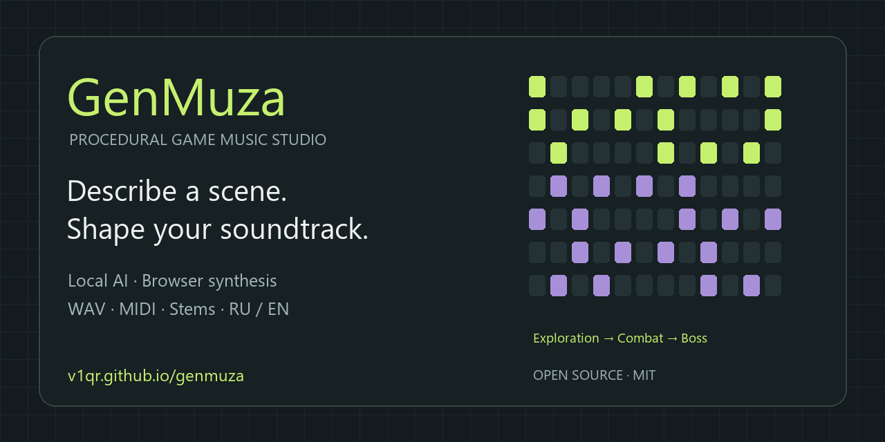

# GenMuza / ГенМуза

**GenMuza — a browser music studio for game soundtracks, procedural music and local AI mood planning.** Describe a scene, review the music plan, generate a track and export WAV, MIDI or a game kit with stems. Inference runs on your device; no Ollama or cloud AI API is required.

Рабочая музыкальная студия для игровых тем. Встроенная MiniLM разбирает описание настроения и составляет редактируемый план. Процедурный движок создаёт ноты, ритмы и аудио на устройстве. Ollama, облачные AI API и установка пакетов не нужны.



## Quick start / Быстрый старт

[**Open the public studio / Открыть студию без установки →**](https://v1qr.github.io/genmuza/)

Choose **English / Русский** in the top bar. The interface language is saved in your browser.

Press **Play demo / Послушать демо** for a 24-second exploration → combat → boss sequence. The demo restores your composition when it finishes. Try **Theme variants / Варианты темы** to compare three takes, choose one, or save favorites and four-bar phrases. The initial AI model download is only needed for neural mood planning.

Для локального запуска и подготовки модели к работе без интернета:

1. Download this repository using **Code → Download ZIP**, then extract it.
2. Install Node.js 18+ if it is not already available.
3. Run `npm run prepare-model` once to download the pinned model for offline use.
4. Run `npm run dev`, open the printed local URL and press ▶ to enable audio.

No `npm install` or build step is needed. On Windows, `Start-GenMuza.cmd` starts the studio. The procedural music engine and the rules-based planning mode work without model weights.

## Listen / Послушать

- [24-second adaptive demo — video](dist/media/demo.mp4) · [WAV](dist/media/demo.wav) · [editable project](dist/media/demo-project.json)
- [Boss Fight — WAV](examples/audio/boss.wav)
- [Tension Ambient — WAV](examples/audio/ambient.wav)
- [Retro 8-bit — WAV](examples/audio/retro.wav)

MIDI and editable JSON projects are included beside each WAV.

## Запуск

Нужен Node.js 18 или новее. В каталоге проекта:

В Windows можно дважды нажать `Start-GenMuza.cmd`: он запускает сервер и открывает студию в браузере. Закрытие окна останавливает сервер. Если порт 5173 занят, используйте фактический адрес, напечатанный в окне.

```powershell
npm run dev
```

Откройте адрес `Local`, напечатанный сервером. Обычно это `http://localhost:5173`. Если порт занят или запрещён Windows, сервер автоматически выбирает свободный. Сначала нажмите ▶, чтобы браузер разрешил аудио. Нельзя просто открыть `index.html` через `file://`: ES-модулям и Worker нужен HTTP.

```powershell
npm test
npm run examples
```

В `examples/audio/` лежат готовые WAV, MIDI и JSON для Boss Fight, Tension Ambient и Retro 8-bit. Сборка не нужна: `dist/` — готовое приложение.

## Локальная нейросеть

Откройте «Музыка по описанию», напишите сцену и нажмите «Составить план». Проверьте параметры, нажмите «Создать музыку по плану», затем ▶. Можно явно указать BPM и написать «без ударных». План и исходное описание сохраняются с JSON-проектом. Быстрый режим по правилам обозначен отдельно и не использует нейросеть.

После подготовки весов в `models/` модель работает без подключения к интернету при запущенном локальном сервере. Для новой копии проекта один раз выполните:

```powershell
npm run prepare-model
```

Это загрузка файлов модели, а не установка отдельной программы. Веса (~118 МБ плюс tokenizer ~17 МБ) исключены из Git. На опубликованном сайте браузер скачивает их с Hugging Face при первом использовании и сохраняет в своём кэше; очистка кэша потребует повторной загрузки. Ваш текст не отправляется для обработки на сервер. Первый запуск включает подготовку модели и смысловых ориентиров; разбор можно отменить.

Используются [Transformers.js 3.8.1](https://huggingface.co/docs/transformers.js/en/index), ONNX Runtime / WASM и [paraphrase-multilingual-MiniLM-L12-v2 q8](https://huggingface.co/Xenova/paraphrase-multilingual-MiniLM-L12-v2/tree/main/onnx), revision `2c4055b12046f11709e9df2c122e59ffbdc2f900`. JavaScript и WASM поставляются внутри `dist/vendor/`, GPU не требуется. Семантическая нейросеть сравнивает смысл описания с наборами настроений и уровней энергии. Музыкальные правила переводят их в композиционные параметры; звук синтезируется музыкальным движком. Маленькая модель может ошибаться в художественной интерпретации, поэтому план показан до применения.

## Возможности

- 8 музыкальных миров, 6 ладов, 4–32 такта, BPM 60–200, бесшовный луп и форма со вступлением, темой, вариацией и финалом.
- Описание сцены → встроенная локальная MiniLM → редактируемая схема → музыка. Примеры описаний, прогресс подготовки и генерации, отмена, отдельный быстрый режим по правилам.
- 18 алгоритмов, собственный seeded PRNG, мотивы, аккордовые прогрессии, подбор близких обращений аккордов и ограничение регистров.
- Фразировка «вопрос → ответ → развитие → каденция», паузы и опорные ноты; отдельный режим чистой формулы. Финал полной композиции разрешается в тонику.
- Три варианта одной темы: раздельное прослушивание, выбор и избранное. Защищённые дорожки и ручные ноты сохраняются.
- Избранные темы и фрагменты по 4 такта с нотами, тембрами и автоматизацией. Библиотека не вытесняет избранное при заполнении.
- 7 дорожек: Kick, Snare, Hi-hat, Bass, Lead, Pad, Bell. Mute, Solo, громкость и защита от перегенерации. Изолированное обновление мелодии или ударных.
- 16-шаговый редактор и Piano Roll для каждого такта; высота, длина и velocity нот, undo.
- 33 тембра: ударный синус, шум, subtractive, additive, FM, wavetable morph, синтетический granular, Karplus–Strong и Shepard glissando.
- ADSR для тональных голосов, attack/decay/release для ударных, LPF/HPF, панорама, saturation, ping-pong delay, многократные отражения reverb.
- Автоматизация громкости и дополнительного low-pass фильтра по тактам, с непрерывной интерполяцией и замкнутой кривой в лупе.
- Exploration / Tension / Combat / Boss: один набор нот с порогами активности. Рендер нового состояния в Worker и crossfade на ближайшей доступной границе такта. События safe / hit / victory, симулятор риска, здоровья и врагов.
- WAV PCM16 stereo 44.1 kHz, MIDI SMF type 1 с 7 музыкальными дорожками, Game Kit ZIP с миксом, stems, MIDI, JSON и браузерным адаптером.
- Автосохранение сессии, библиотека до 30 проектов, JSON round-trip и валидация импорта. Данные остаются в браузере; для переноса между устройствами используйте JSON.

Начальные настройки: Boss Fight, 120 BPM, A minor, 16 тактов, интенсивность 75%, `n² mod 8`, seed `MUZA-2026`.

## Документация

- [Анализ чата и обоих исходных видео](docs/VIDEO-ANALYSIS.md)
- [Архитектура и контракты](docs/ARCHITECTURE.md)
- [Игровой API и интеграция](docs/GAME-API.md)
- [Результаты проверки и границы реализации](docs/VALIDATION.md)

## Технические решения

Интерфейс написан на стандартных ES-модулях вместо React/Tone.js. Это уменьшает зависимости и позволяет запускать проект без установки пакетов. Композитор не зависит от браузера; одинаковые seed, настройки, ревизии, ноты и тембры дают одинаковые события и детерминированный PCM в одном runtime.

Синтез выполняется в Web Worker, проигрывание — через Web Audio API. Предпрослушивание рендерится в 22.05 kHz, экспорт — в 44.1 kHz. Циклическое накопление релизов и эффектов переносит хвосты через границу лупа. Мастер использует общий коэффициент ослабления при превышении 0.94 peak и DynamicsCompressor во время проигрывания.

Это самостоятельная музыкальная студия с перечисленными работающими функциями. FM здесь — одна пара осцилляторов, wavetable — морфинг синтетических гармоник, granular — зерна из генерируемого источника, physical — модель струны. Редактор не включает произвольный граф модулей, многодорожечную аудиозапись или плагины VST. Автоматические метрики тональности и движения голосов не заменяют художественную оценку музыки.

## Contributing / Участие

Bug reports and suggestions are welcome in [Issues](https://github.com/V1QR/genmuza/issues). See [CONTRIBUTING.md](CONTRIBUTING.md) for reproduction details and local checks.

## License / Лицензия

Original project code is available under the [MIT License](LICENSE). Bundled dependencies retain their own licenses and notices in `dist/vendor/`. Model weights are downloaded separately and retain their original license.
